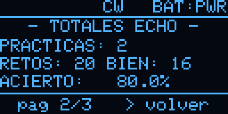

# Chispas EA4ILN

**Entrenador de telegrafía (CW) portátil para radioaficionados, basado en la Heltec WiFi LoRa 32 V3.**


> *"Chispas"* era el apodo que se daba al radiotelegrafista de a bordo.

Chispas reúne en un aparato de bolsillo lo necesario para aprender y practicar CW: un entrenador por el método Koch,
un keyer iámbico, un modo de repetición (Echo), práctica en pareja y QSO por radio LoRa, conexión con el transceptor
(manipulación por KEY, decodificador y memorias) y utilidades de estación, como la propagación, los spots POTA y la
línea gris. Todo se maneja con un encoder rotativo y una pantalla OLED.

<p align="center">
  
  
</p>

---

## Índice

- [Funciones](#funciones)
- [Hardware](#hardware)
- [Conexiones](#conexiones)
- [Compilar y cargar el firmware](#compilar-y-cargar-el-firmware)
- [Manejo](#manejo)
- [Pantallas](#pantallas)
- [Configuración por WiFi (webconf)](#configuración-por-wifi-webconf)
- [Estructura del repositorio](#estructura-del-repositorio)
- [Detalles técnicos](#detalles-técnicos)
- [Hoja de ruta](#hoja-de-ruta)
- [Avisos](#avisos)
- [Créditos y referencias](#créditos-y-referencias)
- [Licencia](#licencia)
- [Autor](#autor)

---

## Funciones

| Función | Descripción | Estado |
|---|---|---|
| **Koch (RX)** | Orden de caracteres de LCWO (lecciones 1–40), grupos aleatorios configurables (wpm, espaciado, caracteres y grupos). La letra nueva de cada lección sale el 25 % de las veces. Al corregir se marcan los caracteres fallados; estadísticas por lección y por carácter (los de más errores). | ✅ |
| **Echo (TX)** | Chispas emite letras y hay que repetirlas con las palas. Ajustes propios (wpm, espaciado, lección, letras por reto, número de retos), resultado al terminar y estadísticas por carácter. | ✅ |
| **TX libre (keyer iámbico)** | Modos A y B, 10–40 wpm, palas normales o invertidas. Descodifica en pantalla lo que se manipula. | ✅ |
| **Práctica Duo por LoRa** | Práctica en pareja entre dos Chispas: uno envía grupos y el otro los recibe y los copia. Tramas digitales a 868 MHz, sin audio. | ✅ |
| **QSO libre por LoRa** | QSO con las palas entre dos Chispas: cada palabra se envía al terminarla y lo recibido suena cuando dejas de manipular (si manipulas mientras suena, se corta). | ✅ |
| **Transceptor (TRX)** | Manipulación de la emisora por KEY (aislada con optoacoplador), decodificador CW del audio de la emisora, QSO con las dos cosas a la vez y 6 memorias con variables (`{MI}`, `{SU}`). Firmware listo. | 🚧 montaje |
| **Propagación** | Índices solares y condiciones por banda de [hamqsl.com](https://www.hamqsl.com/). | ✅ |
| **Spots POTA** | Activaciones en CW publicadas en [pota.app](https://pota.app/). | ✅ |
| **Sol y línea gris** | Salida y puesta del sol, ventanas de línea gris y altura actual del sol para el locator de la estación. Funciona sin conexión. | ✅ |
| **Batería** | Tensión y porcentaje. Detecta cuando no hay batería conectada. | ✅ |
| **Cara de Chispas** | Salvapantallas animado con expresiones y gestos. | ✅ |
| **Configuración por WiFi** | Portal web en castellano, con QR para unirse desde el móvil: red, estación, hora y memorias. | ✅ |
| **Tono por buzzer y auriculares** | Tono CW (400–1000 Hz, 850 por defecto) con volumen y silencio automático del buzzer al conectar auriculares. El piezo suena bajo: falta montar el amplificador. | ✅ / 🚧 |
| **Ahorro de energía** | CPU a 80 MHz sin WiFi, radio dormida fuera de LoRa, pantalla atenuada y apagado automático (deep sleep). | ✅ |
| **GPS** | Posición y locator automáticos. | 🚧 |

---

## Hardware

### Placa principal
- **[Heltec WiFi LoRa 32 V3](https://heltec.org/project/wifi-lora-32-v3/)**: ESP32-S3FN8 (8 MB de flash, sin PSRAM), radio
  LoRa SX1262 a 868 MHz, pantalla OLED de 0,96" (128×64, SSD1306) y cargador de batería LiPo integrado.

### Componentes del prototipo
El prototipo actual se monta en protoboard, sin PCB. Componentes principales:

- Encoder rotativo **KY-040** con pulsador.
- Manipulador de **palas** con clavija estéreo de 3,5 mm.
- **Buzzer piezoeléctrico pasivo** (no activo ni magnético), potenciómetro de volumen de 10 kΩ logarítmico y jack de
  auriculares con conmutación. A 3,3 V el piezo suena bajo: en su sitio irá un amplificador **PAM8302A** con un
  altavoz de 8 Ω (en camino).
- Optoacoplador **PC817** para la salida KEY, con resistencia de 10 kΩ a GND.
- Entrada de audio de la emisora para el decodificador: polarización a 1,65 V, trimmer de nivel y diodos de protección.
- Módulo **GPS** NEO-6M (en camino).
- Batería **LiPo** de 3,7 V con conector JST de 1,25 mm. Comprueba la polaridad antes de conectarla.

El esquema completo (7 hojas), con la lista de componentes y el orden de montaje, está en
[`docs/esquema_protoboard.pdf`](docs/esquema_protoboard.pdf).

---

## Conexiones

| GPIO | Conector | Uso | Estado |
|---|---|---|---|
| 2 | J3-13 | Salida KEY (PC817, 330 Ω, y 10 kΩ a GND). Solo la activa la pantalla TRX | 🚧 montaje |
| 4 | J3-15 | Pala de punto (DIT), pull-up interno | ✅ |
| 5 | J3-16 | Pala de raya (DAH), pull-up interno | ✅ |
| 6 | J3-17 | Entrada de audio del decodificador (ADC1, por DMA) | 🚧 montaje |
| 7 | J3-18 | Tono CW por PWM (buzzer y auriculares) | ✅ |
| 19 / 20 | J2-18 / J2-17 | Encoder CLK / DT | ✅ |
| 48 | J2-14 | Pulsador del encoder | ✅ |
| 47 | J2-13 | RX desde el TX del GPS | 🚧 |
| 3 | J3-14 | Enable del GPS (opcional) | 🚧 |
| 41 / 42 | J3-8 / J3-7 | I2C para un sensor BME280 (opcional) | 🚧 |

Notas:
- El pin 1 de cada conector es el de pad cuadrado, el más cercano al USB, y es GND. La alimentación de 3,3 V está en J3-2/3.
- Todos los módulos van a **3,3 V**. Los GPIO del ESP32-S3 no admiten 5 V.
- GPIO19 y GPIO20 son las líneas USB D−/D+ del S3, pero funcionan como entradas porque la V3 programa a través de un
  conversor CP2102 (probado en placa).

---

## Compilar y cargar el firmware

### Requisitos
- [Visual Studio Code](https://code.visualstudio.com/) con la extensión [PlatformIO IDE](https://platformio.org/), o
  la línea de órdenes de PlatformIO (`pio`).
- Cable USB-C con datos.

Las dependencias se instalan solas al compilar. Están fijadas en [`platformio.ini`](platformio.ini):

| Componente | Versión |
|---|---|
| Plataforma `espressif32` (core Arduino 2.0.17) | 6.13.0 |
| [RadioLib](https://github.com/jgromes/RadioLib) | ^6.6 |
| [Adafruit GFX](https://github.com/adafruit/Adafruit-GFX-Library) y [SSD1306](https://github.com/adafruit/Adafruit_SSD1306) | ^1.11 / ^2.5 |
| [WiFiManager](https://github.com/tzapu/WiFiManager) | ^2.0.17 |
| [ArduinoJson](https://arduinojson.org/) | ^7.2 |

### Pasos
```bash
git clone https://github.com/ea4iln-debug/CHISPAS-EA4ILN.git
cd CHISPAS-EA4ILN
pio run                                  # compila el firmware
pio run -t upload --upload-port COMx     # lo carga en la placa (en Linux/macOS, /dev/ttyUSB0 o similar)
pio device monitor                       # monitor serie a 115200 baudios
```

### Programas de prueba
En [`pruebas/`](pruebas/) hay programas independientes para comprobar el hardware sin tocar el firmware:

| Entorno | Para qué |
|---|---|
| `pio run -e prueba_pines -t upload` | Comprueba los pines del encoder e imprime por serie cada cambio y el sentido de giro |
| `pio run -e prueba_bateria -t upload` | Mide la lectura de batería (media y dispersión) con y sin batería conectada |

Después de usarlos, vuelve a cargar el firmware con `pio run -t upload`.

---

## Manejo

Todo se hace con el **encoder**:

| Acción | Efecto |
|---|---|
| **Girar** | Mueve el foco por las opciones de la pantalla, incluidas las flechas `ant.` y `sig.` para cambiar de pantalla |
| **Pulsar** | Ejecuta la opción con el foco |
| **Pulsar sobre un valor** | Entra en edición (el valor sale en vídeo inverso): girar lo cambia y pulsar otra vez lo confirma |
| **Pulsación larga** | Atajo en algunas pantallas, como salir de la práctica o repetir |
| **Botón PRG** (corto) | *Atrás*: sale de la edición o del submenú y, en las pantallas principales, vuelve a Inicio |
| **Botón PRG** (largo) | Duerme Chispas (deep sleep); se despierta pulsando PRG |

Al cambiar de pantalla, el foco se queda en la flecha que has usado, así que basta con pulsar varias veces seguidas
para recorrer las pantallas en un sentido.

Sin encoder (entorno `heltec_sin_encoder`), todo se hace con el botón PRG: corta = mover el foco, larga = ejecutar y
muy larga (2,5 s) = dormir.

---

## Pantallas

| N.º | Pantalla | Contenido |
|---|---|---|
| 1 | **Inicio** | Nombre, indicativo y versión. Tras unos segundos sin uso aparece la cara de Chispas. |
| 2 | **CW** | Entrenador: `KOCH (RX)`, `ECHO (TX)` y `TX LIBRE` (keyer), con ajustes, práctica y estadísticas |
| 3 | **LoRa** | `PRÁCTICA DUO` (grupos en pareja) y `QSO LIBRE` (con las palas) |
| 4 | **TRX** | Transceptor: `DECODIFICAR`, `OPERAR` (por KEY), `QSO` y `memorias` |
| 5 | **PROP.** | Propagación: índices solares y condiciones por banda |
| 6 | **POTA** | Spots de activaciones en CW |
| 7 | **SOL** | Salida y puesta del sol y línea gris |
| 8 | **CONF.** | Estación, radio LoRa, batería y versión; webconf, reset de fábrica, apagado automático y tono |

La cabecera muestra la hora (local o UTC, a elegir), el nombre de la pantalla y la batería (`PWR` si no hay batería).
Las capturas salen de la propia pantalla, con la orden serie `p` y [`docs/captura_oled.py`](docs/captura_oled.py).

### Entrenador CW

| | | |
|:---:|:---:|:---:|
| <br>Menú | <br>Koch: ajustes | <br>Koch: práctica |
| <br>Koch: más errores | <br>Koch: totales | <br>Koch: lecciones |
| <br>Echo: ajustes | <br>Echo: práctica | <br>Echo: más errores |
| <br>Echo: totales | <br>TX libre (keyer) | |

### LoRa

| | | |
|:---:|:---:|:---:|
| <br>Menú | <br>Práctica Duo | <br>QSO libre |

### Transceptor (TRX)

| | | |
|:---:|:---:|:---:|
| <br>Menú | <br>Decodificar (sin entrada: satura) | <br>Operar |
| <br>QSO | <br>Memorias | <br>Editor (rueda de caracteres) |

### Utilidades y configuración

| | | |
|:---:|:---:|:---:|
| <br>Propagación | <br>Condiciones por banda | <br>Spots POTA |
| <br>Sol y línea gris | <br>Configuración | <br>Webconf |
| <br>QR para unir el móvil | | |

---

## Configuración por WiFi (webconf)

Chispas solo enciende el WiFi cuando lo necesita: en PROP. y POTA, y en SOL si aún no tiene hora. La red, el
indicativo, el locator y la hora se configuran desde el móvil:

1. Ve a **CONF.**, pon el foco en **webconf** y pulsa. Chispas crea la red `Chispas-XXXX` (clave `chispas73`) y
   muestra los datos en pantalla.
2. Únete a esa red. Con la opción **ver qr** aparece un QR que el móvil escanea para unirse directamente.
3. Si la página no se abre sola, entra en **http://192.168.4.1**.
4. En **Red WiFi** eliges tu red y en **Estación, hora y memorias** pones el indicativo, el locator, la hora (formato
   `HH:MM DD-MM-AAAA`), si quieres la hora UTC en la cabecera y las 6 memorias de la pantalla TRX (`{MI}` = tu
   indicativo, `{SU}` = el del corresponsal).

Si en PROP., POTA o SOL no hay red guardada o no conecta, Chispas no abre el portal por su cuenta: muestra un aviso
con la opción **abrir webconf**.

> La clave del portal está definida en `PORTAL_CLAVE`, en `src/main.cpp`. Cámbiala si vas a usar Chispas en un lugar público.

---

## Estructura del repositorio

```
├── src/main.cpp                    Firmware completo (un solo archivo .cpp)
├── include/wm_strings_chispas.h    Textos del portal WiFiManager en castellano
├── pruebas/                        Programas de prueba del hardware (entornos aparte)
├── docs/
│   ├── esquema_protoboard.pdf      Esquema de conexiones del prototipo (7 hojas)
│   ├── gen_esquema.py              Generador del esquema (HTML/SVG → PDF)
│   ├── captura_oled.py             Captura de la pantalla por serie (PNG)
│   └── img/                        Capturas de las pantallas
├── platformio.ini                  Configuración de PlatformIO y dependencias
├── LICENSE                         Licencia del software (GPL-3.0)
├── LICENSE-HARDWARE.md             Licencia del hardware y la documentación (CC BY-NC-SA 4.0)
└── CLAUDE.md                       Notas de desarrollo: estado, decisiones y pendientes
```

---

## Detalles técnicos

- **Temporización CW en tareas FreeRTOS.** La emisión (motor CW) y el keyer corren en tareas de mayor prioridad que
  el bucle principal, con plazos absolutos sobre ticks de 1 ms. La pantalla, la radio o el WiFi no alteran el ritmo
  del Morse (retraso medido: 0 ms).
- **Encoder por interrupción**, con decodificador de cuadratura por tabla que filtra los rebotes.
- **LoRa con tramas digitales**, no audio: un byte por carácter (bit centinela; punto = 0, raya = 1), cabecera
  con tipo (grupo Duo o palabra de QSO), número de secuencia, wpm e indicativo. Antes de transmitir se escucha el
  canal (CAD).
- **Decodificador CW:** el ADC lee el audio de la emisora por DMA a 8 kHz en una tarea del otro núcleo; algoritmo de
  Goertzel en bloques de 12 ms, tono fijo o automático (400–1000 Hz), umbral y velocidad adaptativos. No escucha
  mientras se emite por KEY.
- **Salida KEY con seguridad:** solo se activa en la pantalla TRX y se corta sola si queda activa más de 10 s.
- **Radio:** 868,1 MHz, SF7, 250 kHz, CR 4/7, 10 dBm.
- **Detección de batería ausente:** con USB y sin batería, el cargador de la V3 deja una tensión media similar a la de
  una batería llena, pero oscila. Chispas mide la dispersión de una ráfaga de lecturas para distinguir los dos casos.
- **QR de WiFi** generado con el componente `qrcode` de ESP-IDF incluido en el core, sin librerías adicionales.
- **Cálculo solar** con las ecuaciones de la NOAA a partir del locator Maidenhead.
- **Persistencia** en NVS: configuración del entrenador, keyer, Echo y TRX, estadísticas, datos de la estación y
  memorias.

---

## Hoja de ruta

- [x] Tono por buzzer piezo y auriculares con volumen
- [ ] Amplificador y altavoz para el tono (piezas en camino)
- [x] Estadísticas por carácter (los de más errores, en Koch y Echo)
- [x] QSO por LoRa con las palas
- [ ] Salida KEY aislada para manipular el transceptor (firmware listo; pendiente de montaje)
- [ ] Decodificador CW desde el audio del transceptor (firmware listo; pendiente de montaje y ajuste)
- [ ] GPS: locator y hora automáticos
- [ ] Que el Koch y el Echo repitan más los caracteres con más errores
- [ ] Medida del consumo en reposo (deep sleep)
- [ ] PCB propia

---

## Avisos

- **LoRa a 868 MHz:** Chispas transmite en la banda ISM de 868 MHz (sub-banda 868,0–868,6 MHz, 25 mW, ciclo de
  trabajo del 1 %). Respeta la normativa de tu país.
- **Salida KEY:** manipular un transceptor de radioaficionado requiere la licencia correspondiente.
- **SOTA:** no hay cliente de SOTA. Las condiciones de su API exigen aprobación previa para software de terceros
  como este.
- **APIs externas:** los datos de propagación y de POTA vienen de servicios públicos no oficiales. Chispas los consulta
  con moderación (cada 30 y 2 minutos).

---

## Créditos y referencias

- Método Koch y orden de caracteres de [LCWO.net](https://lcwo.net/).
- [Morserino-32](https://www.morserino.info/), como referencia de diseño.
- Datos de propagación: [hamqsl.com](https://www.hamqsl.com/) (N0NBH). Spots: [pota.app](https://pota.app/).
- Librerías: [RadioLib](https://github.com/jgromes/RadioLib), [Adafruit GFX y SSD1306](https://github.com/adafruit),
  [WiFiManager](https://github.com/tzapu/WiFiManager) (MIT; la traducción de `include/wm_strings_chispas.h` parte de
  su archivo en español) y [ArduinoJson](https://arduinojson.org/).

---

## Licencia

Chispas tiene dos licencias, según el tipo de contenido:

| Parte | Licencia | Archivo |
|---|---|---|
| **Software**: firmware (`src/`), programas de prueba (`pruebas/`), `include/` y scripts (`docs/gen_esquema.py`) | [GNU GPL v3.0 o posterior](https://www.gnu.org/licenses/gpl-3.0.html) | [`LICENSE`](LICENSE) |
| **Hardware y documentación**: esquema, lista de componentes, diseño del montaje, README e imágenes | [CC BY-NC-SA 4.0](https://creativecommons.org/licenses/by-nc-sa/4.0/deed.es) | [`LICENSE-HARDWARE.md`](LICENSE-HARDWARE.md) |

- **Software (GPL-3.0):** es software libre. Puedes usarlo, estudiarlo, modificarlo y redistribuirlo; si distribuyes
  el firmware o una versión modificada, debes hacerlo con la misma licencia y entregar el código fuente.
- **Hardware y documentación (CC BY-NC-SA 4.0):** puedes compartirlos y adaptarlos citando al autor, **sin fines
  comerciales** y con la misma licencia. Para un uso comercial, contacta con el autor.

`include/wm_strings_chispas.h` deriva de WiFiManager y conserva su aviso de licencia MIT. Las librerías externas
mantienen sus propias licencias.

---

## Autor

**EA4ILN**. Proyecto personal de radioafición. 73!
