# Chispas EA4ILN

**Entrenador de telegrafía (CW) portátil para radioaficionados, basado en la Heltec WiFi LoRa 32 V3.**


> *"Chispas"* era el apodo que se daba al radiotelegrafista de a bordo.

> [!WARNING]
> **Versión beta.** Chispas es todavía un prototipo en protoboard: la salida KEY solo se ha probado con un
> transceptor y varios valores del circuito son de partida. Úsalo bajo tu responsabilidad: lee el
> [descargo de responsabilidad](#descargo-de-responsabilidad).

<p align="center">
  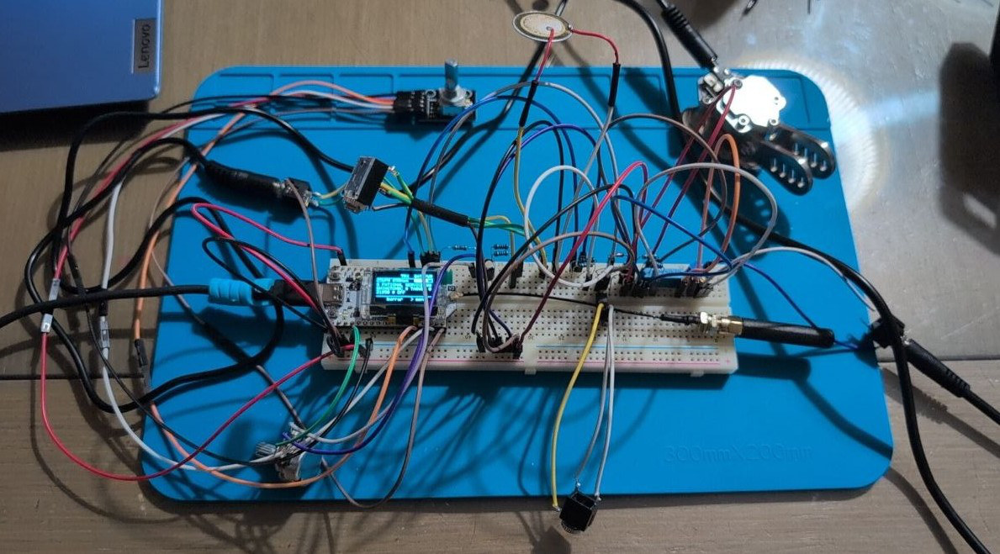
  <br>
  <sub>El prototipo en protoboard (12 de octubre de 2026): Heltec V3 con antena LoRa, encoder, buzzer, volumen,
  manipulador de palas, jacks de auriculares, de KEY y de audio de la emisora, optoacoplador y sensor BME280.</sub>
</p>

Chispas reúne en un aparato de bolsillo lo necesario para aprender y practicar CW: un entrenador por el método Koch,
un keyer iámbico, un modo de repetición (Echo), práctica en pareja y QSO por radio LoRa, conexión con el transceptor
(manipulación por KEY, tune, decodificador y memorias) y utilidades de estación, como la propagación, los spots POTA y
la línea gris. Todo se maneja con un encoder rotativo y una pantalla OLED, y se actualiza solo desde las releases de
GitHub.

<p align="center">
  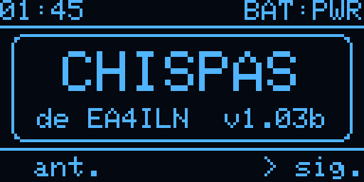
  
</p>

---

## Índice

- [Funciones](#funciones)
- [Hardware](#hardware)
- [Conexiones](#conexiones)
- [Instalar el firmware](#instalar-el-firmware)
- [Actualizar por WiFi (OTA)](#actualizar-por-wifi-ota)
- [Manejo](#manejo)
- [Pantallas](#pantallas)
- [Configuración](#configuración)
- [Estructura del repositorio](#estructura-del-repositorio)
- [Detalles técnicos](#detalles-técnicos)
- [Hoja de ruta](#hoja-de-ruta)
- [Avisos](#avisos)
- [Descargo de responsabilidad](#descargo-de-responsabilidad)
- [Créditos y referencias](#créditos-y-referencias)
- [Licencia](#licencia)
- [Autor](#autor)

---

## Funciones

| Función | Descripción | Estado |
|---|---|---|
| **Koch (RX)** | Orden de caracteres de LCWO (lecciones 1–40), grupos aleatorios configurables (wpm, espaciado, caracteres y grupos). La letra nueva de cada lección sale el 25 % de las veces y, con el **refuerzo**, las letras que más fallas salen más (hasta el doble o el triple). Al terminar se corrige **letra a letra** (marcando cada fallo) o con el **total de fallos**; estadísticas por lección y por carácter. | ✅ |
| **Echo (TX)** | Chispas emite letras y hay que repetirlas con las palas. Ajustes propios (wpm, espaciado, lección, letras por reto, número de retos, refuerzo de las letras con más errores), resultado al terminar y estadísticas por lección y por carácter. | ✅ |
| **TX libre (keyer iámbico)** | Modos A y B, 10–40 wpm, palas normales o invertidas. Descodifica en pantalla lo que se manipula. | ✅ |
| **Práctica Duo por LoRa** | Práctica en pareja entre dos Chispas: uno envía grupos y el otro los recibe y los copia. Tramas digitales a 868 MHz, sin audio. | ✅ |
| **QSO libre por LoRa** | QSO con las palas entre dos Chispas: cada palabra se envía al terminarla y lo recibido suena cuando dejas de manipular (si manipulas mientras suena, se corta). | ✅ |
| **Transceptor (TRX)** | Manipulación de la emisora por KEY (aislada con optoacoplador), **tune** (portadora de 1–10 s), 6 memorias con variables (`{MI}`, `{SU}`, `{WX}`), decodificador CW del audio de la emisora (comprobado con audio Morse real) y QSO con las dos cosas a la vez. | ✅ |
| **Propagación** | Índices solares y condiciones por banda de [hamqsl.com](https://www.hamqsl.com/). | ✅ |
| **Spots POTA** | Activaciones en CW publicadas en [pota.app](https://pota.app/). | ✅ |
| **Sol y línea gris** | Salida y puesta del sol y ventanas de línea gris de hoy y de mañana, y altura actual del sol, para el locator de la estación. Funciona sin conexión. | ✅ |
| **Sensor ambiental (BME280)** | Temperatura, humedad y presión; tendencia de la presión en 3 h con **aviso de tormenta**; altitud barométrica calibrable (útil en SOTA); la temperatura en las memorias con `{WX}`. Opcional: sin sensor, Chispas funciona igual. | ✅ |
| **Configuración en el aparato** | Indicativo, locator, altitud, aceleración del encoder, apagado automático, tono y reset de fábrica, con el encoder. Página STATUS con estación, sistema, WiFi, memoria, arranque y sensor. | ✅ |
| **Configuración por WiFi** | Portal web en castellano, con QR para unirse desde el móvil: red, estación, hora y memorias. | ✅ |
| **Actualización OTA** | Busca la última release en GitHub, avisa si hay versión nueva y la instala por WiFi (TLS validado). | ✅ |
| **Batería** | Tensión y porcentaje. Detecta cuando no hay batería conectada. | ✅ |
| **Cara de Chispas** | Salvapantallas animado con expresiones y gestos. | ✅ |
| **Tono por buzzer y auriculares** | Tono CW (400–1000 Hz, 850 por defecto) con volumen y silencio automático del buzzer al conectar auriculares. El piezo suena bajo: falta montar el amplificador. | ✅ / 🚧 |
| **Ahorro de energía** | CPU a 80 MHz sin WiFi, radio dormida fuera de LoRa, pantalla atenuada y apagado automático (deep sleep). | ✅ |
| **GPS** | Posición y locator automáticos. | 🚧 |

---

## Hardware

### Placa principal
- **[Heltec WiFi LoRa 32 V3](https://heltec.org/project/wifi-lora-32-v3/)**: ESP32-S3FN8 (8 MB de flash, sin PSRAM), radio
  LoRa SX1262 a 868 MHz, pantalla OLED de 0,96" (128×64, SSD1306) y cargador de batería LiPo integrado.

### Componentes del prototipo
El prototipo actual se monta en protoboard, sin PCB. Componentes principales:

- Encoder rotativo **KY-040** con pulsador.
- Manipulador de **palas** con clavija estéreo de 3,5 mm.
- **Buzzer piezoeléctrico pasivo** (no activo ni magnético), potenciómetro de volumen de 10 kΩ logarítmico y jack de
  auriculares con conmutación. A 3,3 V el piezo suena bajo: en su sitio irá un amplificador **PAM8302A** con un
  altavoz de 8 Ω (en camino).
- Optoacoplador **PC817** para la salida KEY, con resistencia de 10 kΩ a GND y un jack con la punta y el anillo
  unidos (vale para emisoras que manipulan por cualquiera de los dos).
- Entrada de audio de la emisora para el decodificador: polarización a 1,65 V, trimmer de nivel y diodos de protección.
- Módulo **GPS** NEO-6M (en camino).
- Batería **LiPo** de 3,7 V con conector JST de 1,25 mm. Comprueba la polaridad antes de conectarla.

El esquema completo (7 hojas), con la lista de componentes y el orden de montaje, está en
[`docs/esquema_protoboard.pdf`](docs/esquema_protoboard.pdf).

---

## Conexiones

| GPIO | Conector | Uso | Estado |
|---|---|---|---|
| 2 | J3-13 | Salida KEY (PC817, 330 Ω, y 10 kΩ a GND). Solo la activa la pantalla TRX | ✅ (probada con una uSDR) |
| 4 | J3-15 | Pala de punto (DIT), pull-up interno | ✅ |
| 5 | J3-16 | Pala de raya (DAH), pull-up interno | ✅ |
| 6 | J3-17 | Entrada de audio del decodificador (ADC1, por DMA) | ✅ |
| 7 | J3-18 | Tono CW por PWM (buzzer y auriculares) | ✅ |
| 38 | J3-11 | Apagado (SD) del amplificador PAM8302A | 🚧 |
| 19 / 20 | J2-18 / J2-17 | Encoder CLK / DT | ✅ |
| 48 | J2-14 | Pulsador del encoder | ✅ |
| 47 | J2-13 | RX desde el TX del GPS | 🚧 |
| 3 | J3-14 | Enable del GPS (opcional) | 🚧 |
| 41 / 42 | J3-8 / J3-7 | I2C (Wire1) del sensor BME280 (opcional) | ✅ |

Notas:
- El pin 1 de cada conector es el de pad cuadrado, el más cercano al USB, y es GND. La alimentación de 3,3 V está en J3-2/3.
- Todos los módulos van a **3,3 V**. Los GPIO del ESP32-S3 no admiten 5 V.
- GPIO19 y GPIO20 son las líneas USB D−/D+ del S3, pero funcionan como entradas porque la V3 programa a través de un
  conversor CP2102 (probado en placa). En Windows hace falta el driver
  [CP210x de Silicon Labs](https://www.silabs.com/developers/usb-to-uart-bridge-vcp-drivers).

---

## Instalar el firmware

Hay dos compilaciones: la normal, para la placa con **encoder**, y la `sin-encoder`, para una placa desnuda que se
maneja solo con el botón PRG.

### Sin compilar (desde la release)
En [Releases](https://github.com/ea4iln-debug/CHISPAS-EA4ILN/releases) están las imágenes listas:

| Archivo | Para qué |
|---|---|
| `chispas-<versión>-usb.bin` | Primera instalación por USB, placa con encoder (imagen completa, se graba en `0x0`) |
| `chispas-<versión>-sin-encoder-usb.bin` | Lo mismo para la placa sin encoder |
| `chispas-<versión>.bin` / `chispas-<versión>-sin-encoder.bin` | Solo la aplicación: las usa la actualización OTA |

Para grabar la imagen completa basta con [ESP Tool web](https://espressif.github.io/esptool-js/) (en Chrome o Edge:
*Connect*, dirección `0x0`, el archivo `-usb.bin` y *Program*) o, con Python:

```bash
pip install esptool
esptool.py --chip esp32s3 --port COMx write_flash 0x0 chispas-1.03b-usb.bin
```

La imagen completa **borra la configuración** guardada (estación, estadísticas y red WiFi): úsala para la primera
instalación. Para las siguientes versiones, usa la [actualización por WiFi](#actualizar-por-wifi-ota), que lo conserva.

### Compilando (PlatformIO)
- [Visual Studio Code](https://code.visualstudio.com/) con la extensión [PlatformIO IDE](https://platformio.org/), o
  la línea de órdenes de PlatformIO (`pio`).
- Cable USB-C con datos.

Las dependencias se instalan solas al compilar. Están fijadas en [`platformio.ini`](platformio.ini):

| Componente | Versión |
|---|---|
| Plataforma `espressif32` (core Arduino 2.0.17) | 6.13.0 |
| [RadioLib](https://github.com/jgromes/RadioLib) | ^6.6 |
| [Adafruit GFX](https://github.com/adafruit/Adafruit-GFX-Library) y [SSD1306](https://github.com/adafruit/Adafruit_SSD1306) | ^1.11 / ^2.5 |
| [WiFiManager](https://github.com/tzapu/WiFiManager) | ^2.0.17 |
| [ArduinoJson](https://arduinojson.org/) | ^7.2 |

```bash
git clone https://github.com/ea4iln-debug/CHISPAS-EA4ILN.git
cd CHISPAS-EA4ILN
pio run                                         # compila el firmware (placa con encoder)
pio run -t upload --upload-port COMx            # lo carga (en Linux/macOS, /dev/ttyUSB0 o similar)
pio run -e heltec_sin_encoder -t upload         # o la versión sin encoder
pio device monitor                              # monitor serie a 115200 baudios
```

### Programas de prueba
En [`pruebas/`](pruebas/) hay programas independientes para comprobar el hardware sin tocar el firmware:

| Entorno | Para qué |
|---|---|
| `pio run -e prueba_pines -t upload` | Comprueba los pines del encoder e imprime por serie cada cambio y el sentido de giro |
| `pio run -e prueba_bateria -t upload` | Mide la lectura de batería (media y dispersión) con y sin batería conectada |

Después de usarlos, vuelve a cargar el firmware con `pio run -t upload`.

---

## Actualizar por WiFi (OTA)

Con una red WiFi guardada (ver [Configuración](#configuración)):

1. Ve a **CONF. > CONFIG > ACTUALIZAR FW**. Chispas se conecta, consulta la última release de este repositorio
   (también las beta) y la compara con la instalada.
2. Si hay una más nueva, la enseña (`NUEVA v1.01b`) y pide confirmar con **instalar**. Descarga el binario de su
   placa (con o sin encoder), lo instala en la otra partición de la flash y reinicia. Si algo falla, la versión
   instalada sigue intacta.
3. Además, cuando Chispas ya tiene el WiFi encendido en PROP. o POTA, mira una vez al día si hay versión nueva y lo
   avisa en el menú (`FW NUEVO: v1.01b`).

Con batería por debajo del 30 % (y sin USB) no instala, para que no se quede a medias. La conexión con GitHub va
cifrada y se comprueba con los certificados raíz de [`include/certificados_github.h`](include/certificados_github.h).

<p align="center">
  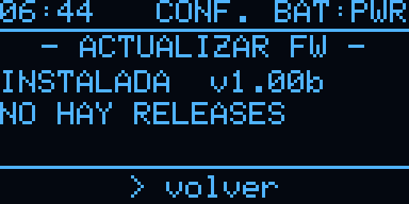
</p>

---

## Manejo

Todo se hace con el **encoder**:

| Acción | Efecto |
|---|---|
| **Girar** | Mueve el foco por las opciones, incluidas las flechas `ant.` y `sig.` para cambiar de pantalla; en las páginas de datos, pasa de página |
| **Pulsar** | Ejecuta la opción con el foco |
| **Pulsar sobre un valor** | Entra en edición (el valor sale en vídeo inverso): girar lo cambia y pulsar otra vez lo confirma. Al girar rápido, los valores largos avanzan de varios en varios (aceleración, ajustable en CONFIG) |
| **Pulsación larga** | Atajo en algunas pantallas, como salir de la práctica o repetir |
| **Botón PRG** (corto) | *Atrás*: sale de la edición o del submenú y, en las pantallas principales, vuelve a Inicio |
| **Botón PRG** (largo) | Duerme Chispas (deep sleep); se despierta pulsando PRG |

Todas las pantallas siguen el mismo esquema:
- **Menú:** título en negativo, opciones `< ... >` y `ant.`/`sig.` abajo.
- **Ajustes:** lista con el nombre a la izquierda y el valor a la derecha (4 a la vista, con barra de desplazamiento),
  y las acciones en el pie (`volver`, o `iniciar` y `volver`).
- **Datos en páginas:** se pasan girando; el pie dice la página (`1/2 INDICES`) y pulsar vuelve.
- **Pantallas de manipular o escuchar** (TX libre, Operar, QSO, Duo, Decodificar): pie corto con lo que se usa sin
  soltar las palas y **menu** para el resto de ajustes.

Al cambiar de pantalla, el foco se queda en la flecha que has usado, así que basta con pulsar varias veces seguidas
para recorrer las pantallas en un sentido.

Sin encoder (compilación `sin-encoder`), todo se hace con el botón PRG: corta = mover el foco, larga = ejecutar y
muy larga (2,5 s) = dormir.

---

## Pantallas

| N.º | Pantalla | Contenido |
|---|---|---|
| 1 | **Inicio** | Nombre, indicativo y versión. Tras unos segundos sin uso aparece la cara de Chispas. |
| 2 | **CW** | Entrenador: `KOCH (RX)`, `ECHO (TX)` y `TX LIBRE` (keyer), con ajustes, práctica y estadísticas |
| 3 | **LoRa** | `PRÁCTICA DUO` (grupos en pareja) y `QSO LIBRE` (con las palas) |
| 4 | **TRX** | Transceptor: `DECODIFICAR`, `OPERAR` (por KEY, con tune), `QSO` y `memorias` |
| 5 | **PROP.** | Propagación: índices solares y condiciones por banda |
| 6 | **POTA** | Spots de activaciones en CW |
| 7 | **SOL** | Sol y línea gris: hoy, ahora y mañana; con el BME280, también AMBIENTE |
| 8 | **CONF.** | `CONFIG` (estación, encoder, apagado, tono, webconf, actualización, depuración y fábrica) y `STATUS` |

La cabecera muestra la hora (local o UTC, a elegir), el nombre de la pantalla y la batería (`PWR` si no hay batería).
Las capturas salen de la propia pantalla con [`docs/captura_oled.py`](docs/captura_oled.py) (necesita
**CONF. > CONFIG > DEPURACION > ORDENES SERIE** en `SI`).

### Entrenador CW

| | | |
|:---:|:---:|:---:|
| 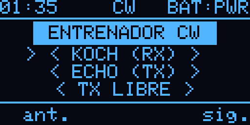<br>Menú | 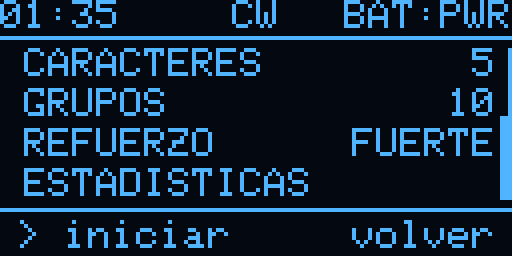<br>Koch: ajustes | 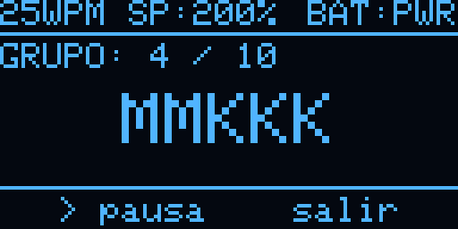<br>Koch: práctica |
| 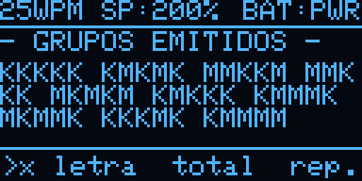<br>Koch: grupos emitidos | 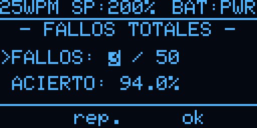<br>Koch: corregir con el total | 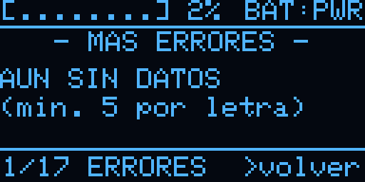<br>Koch: más errores |
| 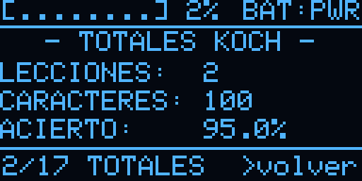<br>Koch: totales | 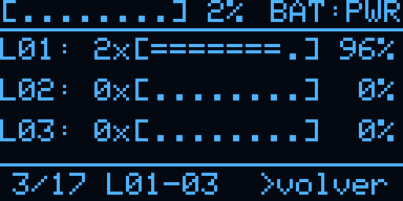<br>Koch: lecciones | 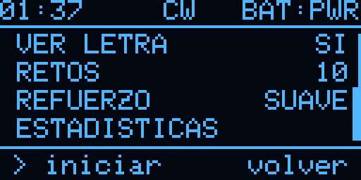<br>Echo: ajustes |
| 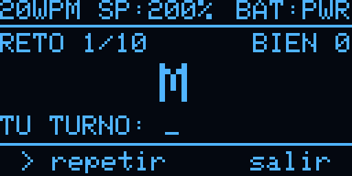<br>Echo: práctica | 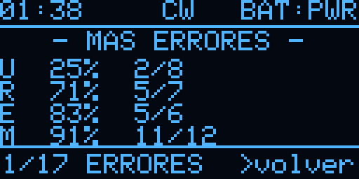<br>Echo: más errores | 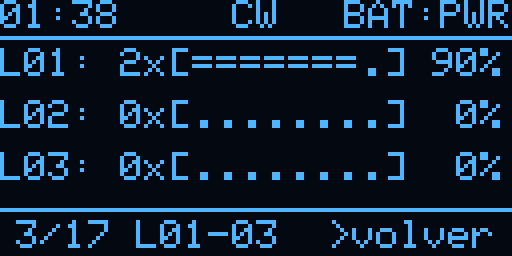<br>Echo: lecciones |
| 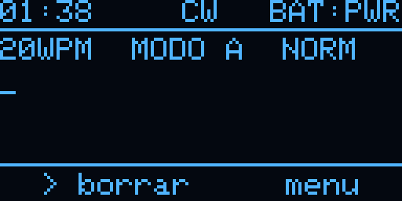<br>TX libre (keyer) | 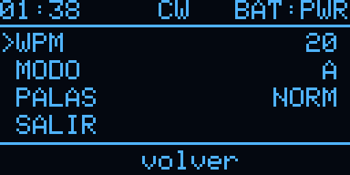<br>TX libre: menu | |

### LoRa

| | | |
|:---:|:---:|:---:|
| 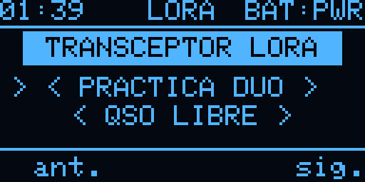<br>Menú | 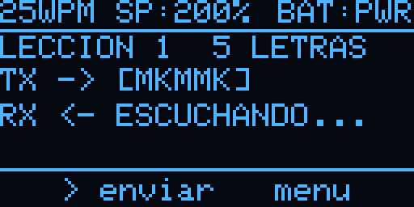<br>Práctica Duo | 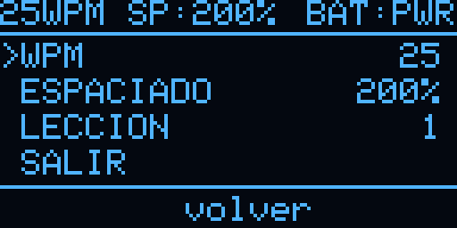<br>Duo: menu |
| 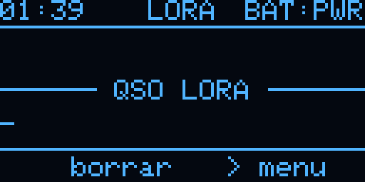<br>QSO libre | 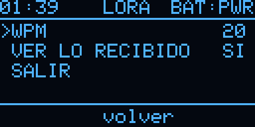<br>QSO libre: menu | |

### Transceptor (TRX)

| | | |
|:---:|:---:|:---:|
| 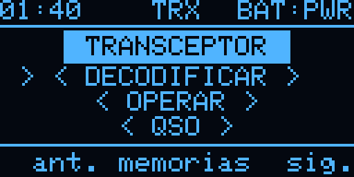<br>Menú | 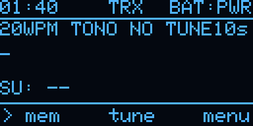<br>Operar | 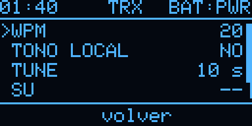<br>Operar y QSO: menu |
| 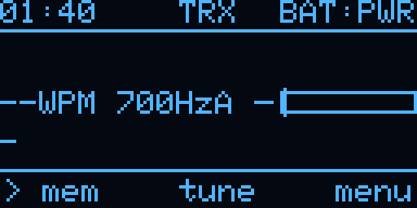<br>QSO | 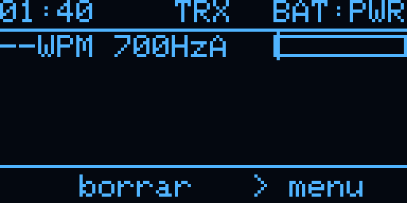<br>Decodificar (sin señal) | 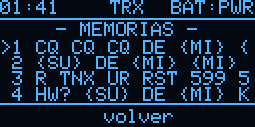<br>Memorias |
| 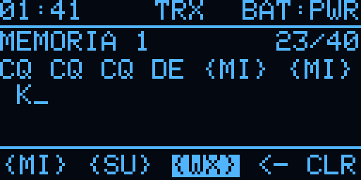<br>Editor (rueda de caracteres, con {WX}) | | |

### Utilidades

| | | |
|:---:|:---:|:---:|
| 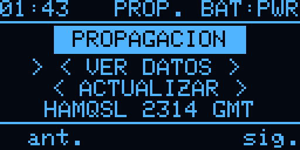<br>Propagación: menú | 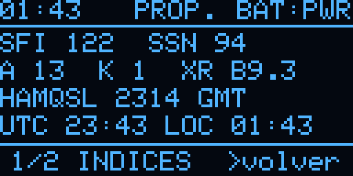<br>Índices | 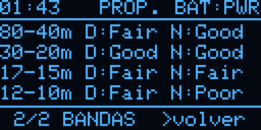<br>Condiciones por banda |
| 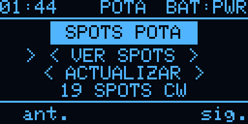<br>POTA: menú | 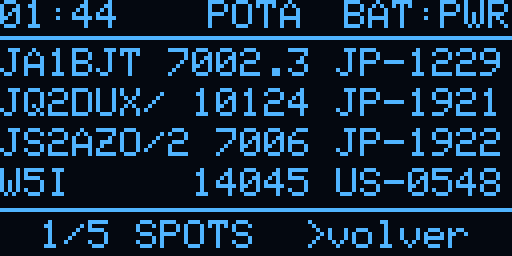<br>Spots POTA | 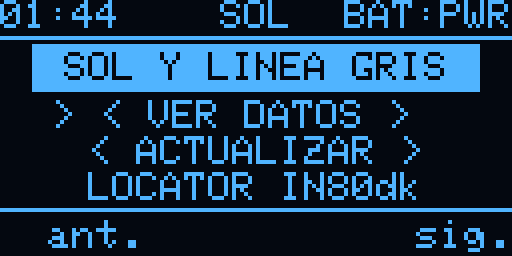<br>Sol: menú |
| 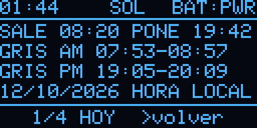<br>Sol: hoy | 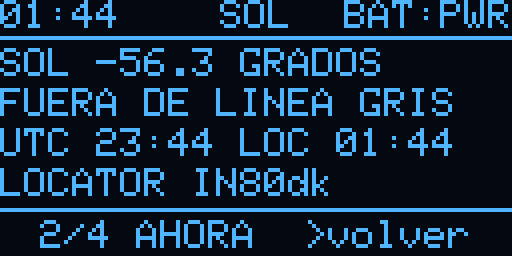<br>Sol: ahora | 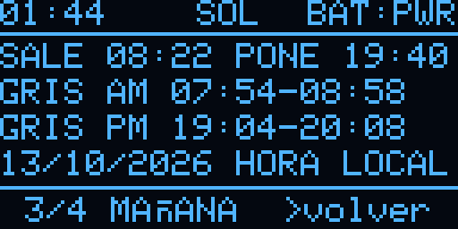<br>Sol: mañana |
| 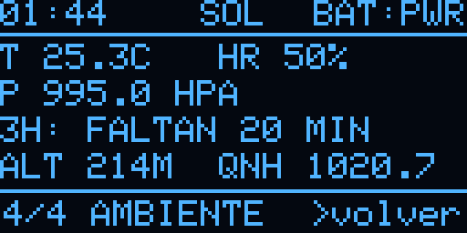<br>Ambiente (BME280) | | |

### Configuración

| | | |
|:---:|:---:|:---:|
| 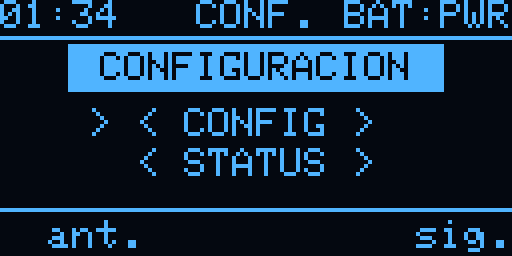<br>Menú | 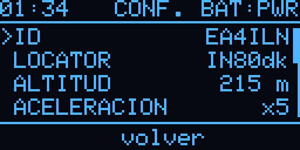<br>CONFIG | 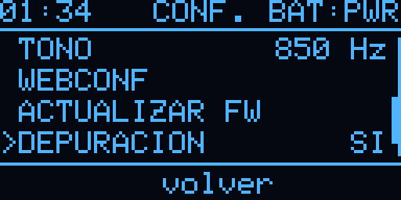<br>CONFIG (final de la lista) |
| 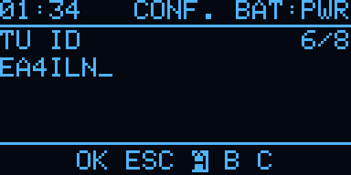<br>Editor del indicativo | 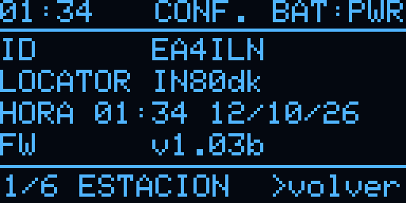<br>STATUS: estación | 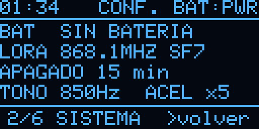<br>STATUS: sistema |
| 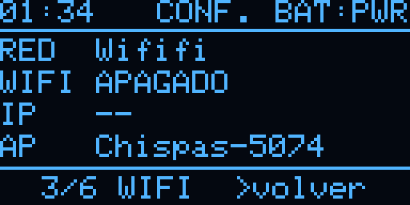<br>STATUS: WiFi | 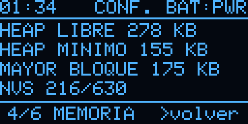<br>STATUS: memoria | 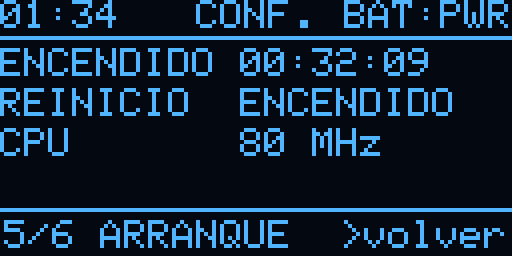<br>STATUS: arranque |
| 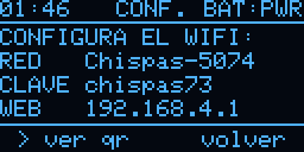<br>Webconf | <br>QR para unir el móvil | <br>Actualizar firmware |
| 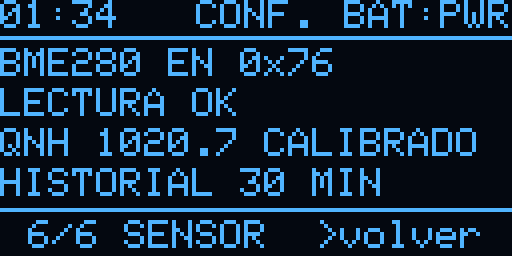<br>STATUS: sensor | <br>Depuración | |

---

## Configuración

### En el aparato
**CONF. > CONFIG** reúne los ajustes generales:

| Opción | Qué hace |
|---|---|
| **ID** | Tu indicativo (3 a 8 letras, cifras y `/`), con la rueda de caracteres del editor |
| **LOCATOR** | Locator Maidenhead de 4 o 6 caracteres (para SOL); se comprueba al guardar |
| **ALTITUD** | Con el BME280: altitud barométrica (con `?` si no está calibrada). Pulsar, girar hasta la altitud real y pulsar calibra el QNH |
| **ACELERACION** | Salto de los valores al girar rápido: `NO` o x2 a x5 |
| **APAGADO** | Minutos sin uso antes de dormir: nunca, 5, 10, 15, 30, 60 o 120 |
| **TONO** | Frecuencia del tono CW (400–1000 Hz), con un pitido de prueba |
| **WEBCONF** | Abre el portal WiFi (ver abajo) |
| **ACTUALIZAR FW** | Actualización por OTA (ver [arriba](#actualizar-por-wifi-ota)) |
| **DEPURACION** | Mensajes y órdenes por serie para pruebas: órdenes serie, diagnóstico, decodificador y retraso CW (todo en `NO` por defecto) |
| **FABRICA** | Borra todo (pide confirmar) y reinicia |

**CONF. > STATUS** muestra, en seis páginas, la estación (ID, locator, hora y versión), el sistema (batería, LoRa,
apagado, tono y aceleración), el WiFi (red guardada, estado, IP y nombre del portal), la memoria, el arranque
(tiempo encendido y motivo del último reinicio) y el sensor ambiental (chip, QNH e historial).

### Por WiFi (webconf)
Chispas solo enciende el WiFi cuando lo necesita: en PROP. y POTA, en SOL si aún no tiene hora, para el portal y
para actualizar. La red WiFi, la hora y las memorias se configuran desde el móvil:

1. Ve a **CONF. > CONFIG > WEBCONF** y pulsa. Chispas crea la red `Chispas-XXXX` (clave `chispas73`) y muestra los
   datos en pantalla.
2. Únete a esa red. Con la opción **ver qr** aparece un QR que el móvil escanea para unirse directamente.
3. Si la página no se abre sola, entra en **http://192.168.4.1**.
4. En **Red WiFi** eliges tu red y en **Estación, hora y memorias** pones el indicativo, el locator, la hora (formato
   `HH:MM DD-MM-AAAA`), si quieres la hora UTC en la cabecera y las 6 memorias de la pantalla TRX (`{MI}` = tu
   indicativo, `{SU}` = el del corresponsal, `{WX}` = la temperatura, p. ej. `WX 18C`, si hay BME280).

Si en PROP., POTA o SOL no hay red guardada o no conecta, Chispas no abre el portal por su cuenta: su menú ofrece
**ABRIR WEBCONF** y **REINTENTAR**.

> La clave del portal está definida en `PORTAL_CLAVE`, en `src/main.cpp`. Cámbiala si vas a usar Chispas en un lugar público.

---

## Estructura del repositorio

```
├── src/main.cpp                    Firmware completo (un solo archivo .cpp)
├── include/
│   ├── wm_strings_chispas.h        Textos del portal WiFiManager en castellano
│   └── certificados_github.h       Certificados raíz para la actualización OTA
├── pruebas/                        Programas de prueba del hardware (entornos aparte)
├── docs/
│   ├── esquema_protoboard.pdf      Esquema de conexiones del prototipo (7 hojas)
│   ├── gen_esquema.py              Generador del esquema (HTML/SVG → PDF)
│   ├── captura_oled.py             Captura de la pantalla por serie (PNG)
│   ├── LICENCIAS_TERCEROS.txt      Avisos de licencia de las librerías incluidas en el firmware
│   └── img/                        Capturas de las pantallas y foto del prototipo
├── platformio.ini                  Configuración de PlatformIO y dependencias
├── LICENSE                         Licencia del software (GPL-3.0)
├── LICENSE-HARDWARE.md             Licencia del hardware y la documentación (CC BY-NC-SA 4.0)
└── CLAUDE.md                       Notas de desarrollo: estado, decisiones y pendientes
```

---

## Detalles técnicos

- **Temporización CW en tareas FreeRTOS.** La emisión (motor CW) y el keyer corren en tareas de mayor prioridad que
  el bucle principal, con plazos absolutos sobre ticks de 1 ms. La pantalla, la radio o el WiFi no alteran el ritmo
  del Morse (retraso medido: 0 ms).
- **Encoder por interrupción**, con decodificador de cuadratura por tabla que filtra los rebotes y medida del tiempo
  entre pasos para la aceleración.
- **LoRa con tramas digitales**, no audio: un byte por carácter (bit centinela; punto = 0, raya = 1), cabecera
  con tipo (grupo Duo o palabra de QSO), número de secuencia, wpm e indicativo. Antes de transmitir se escucha el
  canal (CAD).
- **Decodificador CW:** el ADC lee el audio de la emisora por DMA a 8 kHz en una tarea del otro núcleo; algoritmo de
  Goertzel en bloques de 12 ms, tono fijo o automático (400–1000 Hz), umbral y velocidad adaptativos, silenciador
  (con solo ruido de banda no descodifica) y fin de palabra según la pausa real entre letras. No escucha mientras se
  emite por KEY. Comprobado con audio Morse real.
- **Salida KEY con seguridad:** solo se activa en la pantalla TRX y se corta sola si queda activa más de 10 s (en el
  tune, su duración más 2 s).
- **Actualización OTA:** consulta la API de GitHub, compara versiones (`1.00b` < `1.01b` < `1.01`) y escribe la otra
  partición de aplicación (`default_8MB.csv`: dos de 3,2 MB). TLS validado con certificados raíz incluidos.
- **Radio:** 868,1 MHz, SF7, 250 kHz, CR 4/7, 10 dBm.
- **Detección de batería ausente:** con USB y sin batería, el cargador de la V3 deja una tensión media similar a la de
  una batería llena, pero oscila. Chispas mide la dispersión de una ráfaga de lecturas para distinguir los dos casos.
- **QR de WiFi** generado con el componente `qrcode` de ESP-IDF incluido en el core, sin librerías adicionales.
- **Cálculo solar** con las ecuaciones de la NOAA a partir del locator Maidenhead.
- **Persistencia** en NVS: configuración del entrenador, keyer, Echo y TRX, estadísticas, datos de la estación y
  memorias.
- **Depuración:** en **CONF. > CONFIG > DEPURACION** se activan, sin recompilar, las órdenes por serie (captura
  de pantalla y simulación del encoder) y los mensajes `[DIAG]`, `[DECOD]` y `[CW]`; se guardan en NVS.

---

## Hoja de ruta

Lo pendiente (pruebas, hardware y desarrollo) está en [ROADMAP.md](ROADMAP.md). Lo siguiente: amplificador y
altavoz para el tono, GPS para el locator y la hora automáticos, y POTA sin conexión.

---

## Avisos

- **LoRa a 868 MHz:** Chispas transmite en la banda ISM de 868 MHz (sub-banda 868,0–868,6 MHz, 25 mW, ciclo de
  trabajo del 1 %). Respeta la normativa de tu país.
- **Salida KEY:** manipular un transceptor de radioaficionado requiere la licencia correspondiente.
- **SOTA:** no hay cliente de SOTA. Las condiciones de su API exigen aprobación previa para software de terceros
  como este.
- **Servicios externos:** los datos de propagación y de POTA vienen de servicios públicos. hamqsl.com pide no consultar
  su XML más de una vez por hora y Chispas lo respeta. pota.app no publica condiciones para su API: Chispas la consulta
  cada 2 minutos, solo con la pantalla POTA abierta. La API de GitHub se consulta al pedir la actualización y, como
  mucho, una vez al día para el aviso.

---

## Descargo de responsabilidad

Chispas es un proyecto personal de radioafición, sin ánimo de lucro, en fase beta. Se ofrece **tal cual, sin
garantía de ningún tipo**: ni de que funcione, ni de que sirva para un fin concreto, ni de que esté libre de errores
(ver las licencias GPL-3.0 y CC BY-NC-SA 4.0).

- **Responsabilidad:** quien monte, modifique o use Chispas lo hace bajo su propia responsabilidad. El autor no
  responde de daños en personas, en la placa, en el transceptor o en otros equipos, ni de pérdidas de datos o de
  cualquier otro perjuicio derivado de su uso.
- **Circuitos:** los esquemas y valores son de un prototipo y en buena parte no se han probado en banco. Revísalos
  antes de montarlos y comprueba con el polímetro antes de conectar nada.
- **Transceptor:** conectar Chispas a una emisora (salida KEY y entrada de audio) puede dañar uno u otro equipo si se
  monta mal. Usa siempre el aislamiento previsto (optoacoplador) y prueba primero sin la emisora. La salida KEY tiene
  un corte de seguridad por software, pero no sustituye a la vigilancia del operador.
- **Batería LiPo:** una batería mal conectada, dañada o cargada sin vigilancia puede calentarse o incendiarse.
  Comprueba la polaridad y no la dejes cargando desatendida.
- **Actualizaciones:** no apagues Chispas mientras instala una versión. Si algo sale mal, se puede volver a grabar
  siempre por USB.
- **Normativa:** la emisión por LoRa (868 MHz) y la manipulación de un transceptor de radioaficionado están sujetas a
  la normativa de cada país y, en el segundo caso, a tener la licencia correspondiente. Cumplirla es cosa de quien
  opera el equipo.
- **Servicios externos:** los datos de propagación y de POTA vienen de servicios de terceros que pueden cambiar o
  dejar de funcionar; no deben usarse para decisiones críticas.

---

## Créditos y referencias

- Método Koch y orden de caracteres de [LCWO.net](https://lcwo.net/) (Fabian Kurz, DJ5CW).
- [Morserino-32](https://www.morserino.info/), como referencia de diseño (no se ha copiado código).
- [Meshtastic](https://meshtastic.org/), como referencia de datos de la Heltec V3 (tensión del TCXO, lectura de la
  batería); no se ha copiado código.
- Datos de propagación: [HAMQSL.com](https://www.hamqsl.com/), de Paul L. Herrman, N0NBH, y las fuentes que él cita.
  Spots: [pota.app](https://pota.app/) (Parks on the Air).
- Cálculo solar con las ecuaciones de la [NOAA](https://gml.noaa.gov/grad/solcalc/calcdetails.html) (dominio
  público).
- Librerías:

  | Librería | Licencia |
  |---|---|
  | [Arduino-ESP32](https://github.com/espressif/arduino-esp32) (core) | LGPL-2.1 |
  | [ESP-IDF](https://github.com/espressif/esp-idf), incluido en el core (ADC por DMA, `qrcode`, mbedTLS) | Apache-2.0 |
  | [QR Code generator](https://www.nayuki.io/page/qr-code-generator-library) (Project Nayuki), dentro del `qrcode` de ESP-IDF | MIT |
  | [RadioLib](https://github.com/jgromes/RadioLib) | MIT |
  | [Adafruit GFX](https://github.com/adafruit/Adafruit-GFX-Library) y [Adafruit SSD1306](https://github.com/adafruit/Adafruit_SSD1306) | BSD |
  | [Adafruit BusIO](https://github.com/adafruit/Adafruit_BusIO) | MIT |
  | [WiFiManager](https://github.com/tzapu/WiFiManager) (la traducción de `include/wm_strings_chispas.h` parte de su archivo en español) | MIT |
  | [ArduinoJson](https://arduinojson.org/) | MIT |

---

## Licencia

Chispas tiene dos licencias, según el tipo de contenido:

| Parte | Licencia | Archivo |
|---|---|---|
| **Software**: firmware (`src/`), programas de prueba (`pruebas/`), `include/` y scripts (`docs/*.py`) | [GNU GPL v3.0 o posterior](https://www.gnu.org/licenses/gpl-3.0.html) | [`LICENSE`](LICENSE) |
| **Hardware y documentación**: esquema, lista de componentes, diseño del montaje, README e imágenes | [CC BY-NC-SA 4.0](https://creativecommons.org/licenses/by-nc-sa/4.0/deed.es) | [`LICENSE-HARDWARE.md`](LICENSE-HARDWARE.md) |

- **Software (GPL-3.0):** es software libre. Puedes usarlo, estudiarlo, modificarlo y redistribuirlo; si distribuyes
  el firmware o una versión modificada, debes hacerlo con la misma licencia y entregar el código fuente.
- **Hardware y documentación (CC BY-NC-SA 4.0):** puedes compartirlos y adaptarlos citando al autor, **sin fines
  comerciales** y con la misma licencia. Para un uso comercial, contacta con el autor.

`include/wm_strings_chispas.h` deriva de WiFiManager y conserva su aviso de licencia MIT. Las librerías externas
mantienen sus propias licencias (ver [Créditos y referencias](#créditos-y-referencias)); todas son compatibles con la
GPL-3.0. El repositorio solo contiene código fuente: PlatformIO descarga las librerías al compilar. Los binarios de las
releases van acompañados de [`docs/LICENCIAS_TERCEROS.txt`](docs/LICENCIAS_TERCEROS.txt), con los avisos de licencia
de las librerías que incluyen.

Las capturas de `docs/img/` muestran datos de terceros (propagación de HAMQSL.com y spots de pota.app), que siguen
siendo de sus autores.

---

## Autor

**EA4ILN**. Proyecto personal de radioafición. 73!
